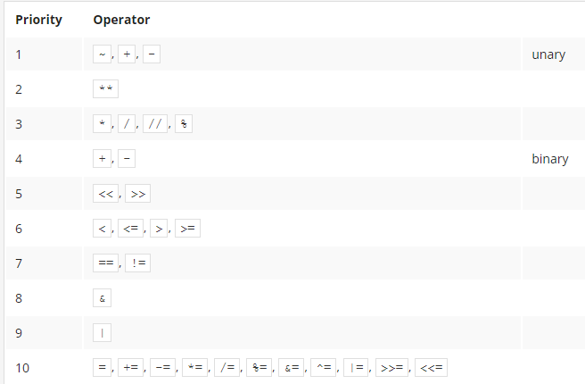
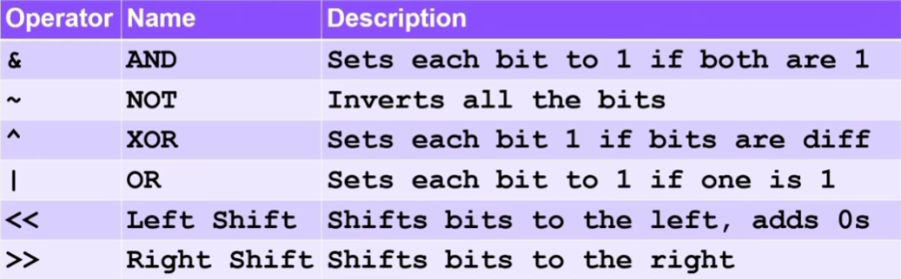

# Programming / Python Key Essentials

## Languages

- Natural language: English, Portuguese
- Machine Language: Language that the computer understands - binary code, hexadecimal
- High-level programming language: Close to natural language, however can give commands to a computer

## Lexis

- Vocabulary of a language
- In Python: keywords (`continue`, `for`, `+`, `'Hello'`)

## Synthax

- The structure the language must follow
- Example:
  - Python 2: `print "Hello World"`
  - Python 3: `print("Hello World")`

## Semantics

- Meaning of your code
- `x = 10 + 5` -> means the created variable x will receive the result of the computation five 10 + five

## Compiled vs Interpreted languages

- Compiled
  - Needs to be compiled before it is executed
  - Example: C++
  - Advantages
    - Usually has faster execution
    - End user only needs the compiled file
    - Stored as machine language
  - Disavantages
    - Compilation time
    - Amendments take more time to test
    - Needs different compilation for different hardware platforms
- Interpreted
  - Doesn't need compilation to be executed, but it need a interpreter in order to run
  - Example: Python
  - Advantages
    - Runs immediately
    - Multiple hardware platforms
  - Disavantages
    - End user needs the interpreter installed
    - Usually slower
    - Stored as high-level language (easy to decipher)

## Keywords

- Reserved keywords: Can't be used as variables

## Indentation

- Mandatory in Python
- Changes the workflow directly. Everything you ident after an `if` will be inside it.

## Variables

- Naming rules
  - Can use upper and lowercase letters, digits, underscores
  - Must begin with a letter or underscore
  - They are case sensitive
  - Cannot use keywords (even though you can use a keyword with different casing (like IF) as variable, it is not recommended)
  - Must have an unique name
- Implicit declaration
  - You can set a variable to something without defining it's type

## Naming Conventions

- PEP-8: Official style guide for Python
- [Naming convention](https://peps.python.org/pep-0008/#naming-conventions): You can use, single upper and lower case, lowercase, uppercase, lower_case_with_underscores (for mutable variables), etc.
- **Class names**: CapWords
- **Functions and variable names**: lower_case_with_underscores
- **Functions and methods arguments**: lowercase. If it clashes with a reserved keyword, use a underscore after the word (eg. `class_`)
- **Method names and instance variables**: lowercase with words separated by underscores as necessary to improve readability
- **Constants**: all capital letters with underscores separating words: MY_CONSTANT

## Operators

- Priority table -> in the same line they have the same priority, the first one that appear will be executed first

- If you use a float number with integer to make a computation, the result will always be a float (division always results in a float)
- `//` -> integer division (unless we use a float in the computation), round down the result
- Many operators are binary operators (work with 2 components, eg. `5 - 5`)
- However, they can be unary operator, like to indicate a negative number (eg. `-5`)
- Operator binding: if you have multiple of the same operator, you will have the priority from left to right
  - Exception: exponents are from the right to the left
- String operators
  - Concatenation: using `+` operator to concatenate words `'gui' + ' ' + 'pi'`
  - Repeat string: `*` operator
- Assignment operator: `=` operator
- Shortcut operator
  - `+=` takes the same value of the left to the operator and the to the right side (works with any operator)
  - `-=`, `*-`, `/=`
- Boolean operators
  - `not` reverses the Boolean value
  - `and`, `or`, `^` (xor operator)
- Relational operators
  - `==`, `!=`, `>`, `<`, `=>`, `=<`
- Bitwise operators
  - Manipulation of bits in binary operations

## Float Accuracy

- Python isn't precise when using floating numbers
- If you sum `.1 + .2` you will get `0.30000000000000004`. Thus, you cannot check for things like `0.1 + 0.2 == 0.3`

## Type casting

- Casting means transform a type of value into another (like a string into an integer)
- Functions
  - `int()`
    - Will floor the floating and convert strings (if possible) into integer
    - Cannot type casting a string that is a float directly
  - `float()`
  - `str()`
  - `bool()`
    - Anything other than zero or empty string, will be True

## Functions

- Must be defined before their invocation
- Can have an **effect** (change something) or a **result** (return something)
- Functions workflow:
  - Python checks if there is another function with the same name if you are defining a new one
  - Python checks the arguments to see if there are missing ones or more than expected
  - Python leave the code and goes to the function carrying the arguments
  - Python executes its code causing the desired effect/result
  - Python returns to the code
- Positional arguments must be defined before keyword args
- Functions are first defined, then invoked, have their body executed, and finally return to the line after the function invocation
- They need to be defined BEFORE they are invoked
- You cannot have a function and a variable with the same name

### Basic Python built-in functions

- `print(*objects, sep=' ', end='\n', file=None, flush=False)`
  - Prints anything into the console
  - No return
  - Can have as many positional arguments to print as you want
  - Positional arguments can be of any kind since they will be cast to string when printing
  - Have 4 keyword arg
    - `sep`: How the arguments will be separated
    - `end`: How the printed line will end
    - `file`: The file argument must be an object with a write(string) method
    - `flush`: Output buffering is usually determined by file. However, if flush is true, the stream is forcibly flushed
- `input(prompt, /.)`
  - Receives something typed by the user
  - Always a string
  - Positional argument prompt will be a text displayed before the user enters the text
  - If you know or you check if the input can be another type of variable (like an int), you can cast it to the other type and then you can make math operations

### Functions vs Methods

- Function
  - Does not belong to any type of object
  - It gets data, may create new data and (generally) produces a result
  - Is owned by the whole code
  - Example: `result = function(arg)`
- Method
  - Is a specifc kind of function
  - Is able to change the state of a selected entity
  - Is owned by the data it works for
  - Example: `result = data.method(arg)

### Decomposition

- Decomposition is the practice of breaking your code in an reusable way, allowing it to be implemented as a set of separately written functions packed together in different modules
- Functions can come from python, modules of even inside your own code

### Parameterized functions

- Functions are able to accept data through parameters defined in it
- Parameters only exist inside functions they have been defined
  - Arguments exist outside functions
- Assigned a value to the parameter is done at the time of the function's invocation
- You CAN have a variable with the same name as a function parameter (because the latter only exists inside the function)
- You can also have keyword arguments in your function so during invocation you have to explicitly tell which arguments is receiving a specific value

### Return instructions

- Functions can, besides having an effect, have results, i.e. `return` a value
- The `return` keyword can also be used to make a function stop earlier
- If the function returns something but you don't use (for example, assign it to a variable), the value will be lost
- If a function returns nothing, it will implicitly return `None`

### Functions Scope

- The scope of a name is the part of the code where the name is properly recognizable
  - For example, the scope of a function's parmeters it the function itself, it is inaccessible from the ouytside
  - However the opposite is not true. A variable created outside a function can be accessed inside it (but you can't access the outside variable if the function has a variable inside it with the same name)
  - A variable existing outside a function has a scope inside the functions' bodies, excluding those of them which define a variable of the same name
- You can use the `global` keyword to access a variable outside its context
- Changing the parameter's value doesn't propagate outside the function (in any case, not when the variable is a scalar)

## The `None` value

- Does not represetn any reasonable value
- MUST NOT take part in any expression (like `None + 2`)
- You can assign it to a variable or compare something to None

## Miscellaneous

- You can use `\` to break a line in Python